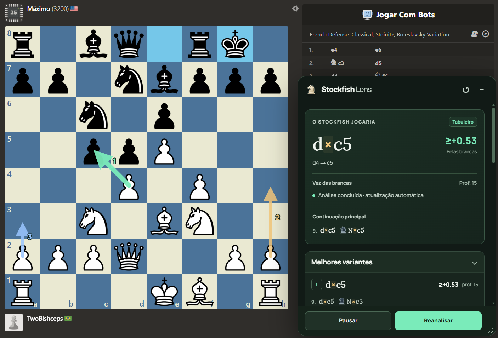
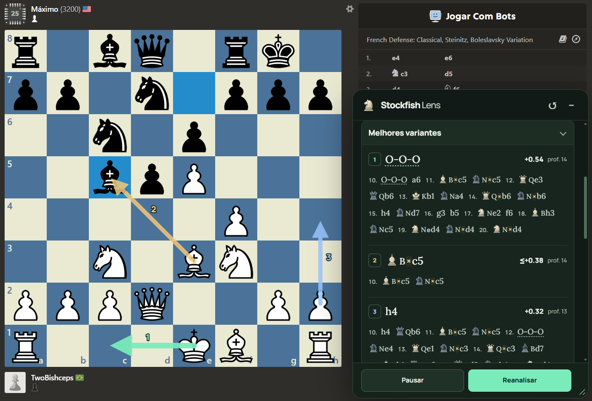

<p align="center"></p>

# Stockfish Lens

**Estude partidas contra os bots do Chess.com com o Stockfish ao lado do tabuleiro.**

Extensão Chrome Manifest V3 que mostra o lance que o Stockfish faria, suas principais continuações e os dados da pesquisa. O motor **Stockfish 19 roda localmente no navegador**, sem chave de API ou servidor de análise.

[](https://github.com/gustavolafz/stockfish-lens/releases/latest)
[](https://github.com/gustavolafz/stockfish-lens/actions/workflows/ci.yml)
[](LICENSE)

[**Baixar a versão 1.0.0**](https://github.com/gustavolafz/stockfish-lens/releases/tag/v1.0.0) · [Instalação](#instalação) · [Desenvolvimento](#desenvolvimento) · [Privacidade](PRIVACY.md)

## Para que serve

O uso proposto é **estudar jogando contra o computador em “Jogar com bots” no Chess.com**: compare sua ideia com a sugestão do motor, examine alternativas e acompanhe como a avaliação muda a cada lance. O Stockfish da extensão é independente do bot adversário e não executa lances por você.

> **Deixe o modo de foco do Chess.com desligado.** A integração automática depende da lista de lances. No modo de foco, esse histórico fica oculto ou indisponível e a leitura da posição não é suportada. Mantenha a lista de lances acessível durante o estudo.

## Na prática

Os prints abaixo foram enviados pelo autor durante partidas contra o bot do Chess.com.

### Melhor lance e setas



### Compare as continuações



## Instalação

Requer Chrome 110+ ou um navegador Chromium compatível com extensões Manifest V3. A validação automatizada usa Chromium; a distribuição desta versão é por instalação manual.

1. Baixe **`stockfish-lens-1.0.0.zip`** na [release 1.0.0](https://github.com/gustavolafz/stockfish-lens/releases/tag/v1.0.0).
2. Extraia o ZIP para uma pasta permanente. **Não selecione o ZIP diretamente no Chrome.**
3. Abra `chrome://extensions` e ative **Modo do desenvolvedor**.
4. Clique em **Carregar sem compactação** e selecione a pasta que contém `manifest.json`.
5. Abra uma partida em **Jogar com bots** no Chess.com, com o modo de foco desligado.
6. O painel inicia **minimizado no canto inferior direito**. Clique em **+** para expandir; a análise já funciona com ele minimizado.

Para atualizar, substitua os arquivos na mesma pasta, clique em **Recarregar** no cartão da extensão e recarregue a página do Chess.com. Seus ajustes de aparência e análise ficam salvos. Ao expandir, o painel restaura a posição e o tamanho que você configurou.

A release também inclui um ZIP completo de fontes e `SHA256SUMS.txt`. No Linux/macOS, use `sha256sum -c SHA256SUMS.txt` na pasta que contém os dois ZIPs para conferir os downloads.

## O que você pode acompanhar

- **Melhor lance**, coordenadas, avaliação e continuação principal.
- **Uma, três ou cinco variantes**, com profundidade e linha completa, incluindo numeração real dos lances.
- **Até três setas**, com cores e números correspondentes às variantes, controles individuais e tamanho entre 50% e 200%.
- **Notação legível:** símbolos próprios e letras das peças, capturas `×`, promoções `=`, xeque `+`, mate `#`, roques e desambiguação destacados.
- **Dados do motor:** profundidade seletiva, posições pesquisadas, posições por segundo, hash, tempo e resposta esperada; outros campos aparecem quando emitidos.
- **Chances estimadas de vitória, empate e derrota**, fornecidas pelo modelo WDL do motor.
- **Painel ajustável:** arraste pelo cabeçalho, redimensione pelo canto e ajuste todas as fontes entre 80% e 150% em **Aparência**.
- **FEN manual**, cópia da posição e exportação do log UCI, com até 3.000 mensagens.

A análise atualiza automaticamente após os lances e ao navegar pelo histórico. Durante animações, a extensão aguarda uma posição confirmada e descarta respostas antigas.

### Como ler as avaliações

O valor com sinal é sempre **pelas brancas**: `+0,50` favorece as brancas; `−0,50` favorece as pretas. Valores `+M3` / `−M3` indicam mate para a cor correspondente; `≥` e `≤` indicam limites de uma pesquisa incompleta. A barra WDL refere-se ao **lado que tem a vez**, identificado no painel. Essas estimativas não são garantias de resultado.

O filtro **Ocultar alternativas desfavoráveis**, ligado por padrão, pode esconder as setas do 2º e do 3º lances quando a avaliação favorece o adversário de quem joga. A melhor sugestão continua disponível e todas as variantes permanecem no painel. Uma pequena avaliação negativa não significa, por si só, um erro. Desative o filtro para mostrar todas as setas selecionadas.

### Atalhos

| Padrão | Ação |
| --- | --- |
| `Alt + Shift + 1` | Alternar a seta do melhor lance |
| `Alt + Shift + 2` | Alternar a seta do 2º lance |
| `Alt + Shift + 3` | Alternar a seta do 3º lance |
| `Alt + Shift + 0` | Alternar as três setas |

O popup mostra os atalhos registrados e abre `chrome://extensions/shortcuts` para personalizá-los. Ativar o 2º ou 3º lance habilita pelo menos três variantes. O filtro de alternativas continua valendo com os atalhos.

## Limitações conhecidas

- **Modo de foco desligado e histórico disponível:** a extensão reconstrói o FEN pelos lances e confere as peças. Não inventa informações como roque, en passant ou a vez de jogar quando o histórico falta.
- **Xadrez padrão:** a integração automática não cobre Chess960 ou partidas iniciadas por uma posição personalizada sem histórico completo. Use **Analisar uma posição → Analisar FEN** nesses casos.
- **Pré-movimentos:** nos formatos de DOM validados, o painel continua analisando a posição real enquanto o site mostra a prévia. As setas ficam temporariamente ocultas e voltam ao cancelar ou executar a fila. Prévias não reconhecidas continuam exigindo uma posição confirmada.
- **Dependência do HTML do site:** mudanças no Chess.com podem exigir atualização. O projeto usa os tabuleiros e históricos fornecidos como fixtures de regressão.
- **Motor lite:** a variante usada é `Stockfish.js 19 lite-single`, com rede NNUE reduzida, uma thread e 32 MiB de hash. Pode avaliar de forma diferente da versão completa; aumentar MultiPV divide o tempo de pesquisa entre mais variantes. Tablebases não estão incluídas.

## Desenvolvimento

Requer Node.js **20.19+** e npm. `.nvmrc` e a configuração do CI usam Node.js 24.

```sh
git clone --recurse-submodules https://github.com/gustavolafz/stockfish-lens.git
cd stockfish-lens
npm ci
npm run build
```

Carregue a pasta **`dist/`** em `chrome://extensions`. O projeto funciona a partir da própria raiz, sem depender de uma pasta pai do Stockfish.

Se clonou sem `--recurse-submodules`, recupere o motor com:

```sh
git submodule update --init --recursive
```

O submódulo **`vendor/stockfish.js`** está fixado em **v19.0.1**, a mesma versão da dependência npm usada pelo navegador. Ele contém o código C++ e as adaptações para WebAssembly. A build da extensão usa os binários fixados do npm; não exige compilar C++ ou instalar Emscripten. Veja [Motor e origem dos arquivos](docs/ENGINE.md).

### Validar e empacotar

```sh
npm test
npx playwright install chromium
npm run test:browser
npm run test:ux
npm run package
npm run verify:package
```

Para usar um Chromium já instalado:

```sh
CHROMIUM_PATH=/caminho/para/chrome npm run test:browser
CHROMIUM_PATH=/caminho/para/chrome npm run test:ux
```

As suítes instalam a extensão em um perfil temporário, servem os HTMLs locais sanitizados e executam o WASM real. Cobrem sincronização entre lance, avaliação e seta; variantes; atalhos; rotação e tela cheia; pré-movimentos; promoções localizadas; navegação e falta de histórico; aparência e layout em telas menores. A validação automatizada não depende de uma conta autenticada no site e não substitui a conferência da integração ao vivo após mudanças no Chess.com.

`npm run package` gera em `release/`:

| Arquivo | Conteúdo |
| --- | --- |
| `stockfish-lens-1.0.0.zip` | Extensão pronta para carregar no Chrome |
| `stockfish-lens-1.0.0-source.zip` | Fontes da extensão, submódulo do motor, rede lite, docs e scripts |
| `SHA256SUMS.txt` | Checksums dos dois ZIPs |

O ZIP **Source code** criado automaticamente pelo GitHub não traz o conteúdo dos submódulos. Use o ZIP completo de fontes anexado à release ou o clone recursivo.

O desenho do ícone está em `assets/icon.svg`; os PNGs são versionados e podem ser regenerados com `npm run icons`. Eles já estão disponíveis para uma build normal.

## Organização

| Pasta | Uso |
| --- | --- |
| `src/` | Leitura da posição, análise, painel, popup e motor |
| `assets/` | Ícones e rede neural lite com a respectiva licença |
| `docs/` | Prints reais, origem do motor e histórico de desenvolvimento |
| `tests/` | Regressões e suítes de Chromium |
| `scripts/` | Build, ícones, pacotes e verificação |
| `vendor/stockfish.js/` | Submódulo fixado do código do motor |
| `dist/`, `release/`, `artifacts/` | Arquivos gerados, fora do Git |

## Privacidade e licença

A análise ocorre localmente; a extensão não usa servidor próprio, telemetria ou anúncios. Somente preferências e layout são salvos no armazenamento local do Chrome. Leia a [política de privacidade](PRIVACY.md).

Código da extensão sob [GPL-3.0-only](LICENSE). O motor, chess.js, as fontes tipográficas e a rede NNUE mantêm seus avisos e licenças em [NOTICE.txt](NOTICE.txt) e no pacote. Este é um projeto independente, sem vínculo oficial com o Chess.com ou a equipe Stockfish.

[Changelog](CHANGELOG.md) · [Como contribuir](CONTRIBUTING.md) · [Contrato de manutenção](AGENTS.md)
